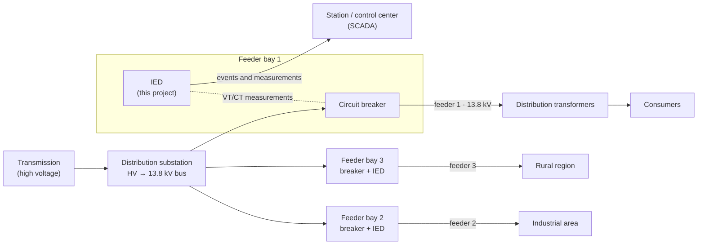

# Product Concept

## Purpose

Field Device Lab emulates a fictional three-phase distribution-feeder monitoring
intelligent electronic device (IED). It processes synthetic electrical measurements,
calculates grid quantities, detects and records abnormal conditions, and presents
device and feeder status locally and remotely.

The project begins as a host-based simulation and may later be distributed across an
ESP32 RTOS measurement node and a BeagleBone Black running a custom Yocto Linux image.
Future increments may provide a real-time local HMI and standards-informed
IEC 60870-5-104 and IEC 61850 interoperability experiments.

This is an educational monitoring system. It is not protection equipment, production
control equipment, or a standards-conformant utility product.

## Background: distribution feeders and IEDs

Electricity reaches a distribution substation at high voltage and is stepped down to
medium voltage, typically 13.8 kV in Brazil. Several medium-voltage lines leave the
substation bus, each supplying a neighbourhood, an industrial area or a rural region.
Each of these lines is a **distribution feeder**. Along the feeder, distribution
transformers step the voltage down again for end consumers.

Each feeder has a circuit breaker at the substation and one or more **intelligent
electronic devices (IEDs)** beside it. An IED is an embedded computer that:

- reads voltage and current through instrument transformers (voltage transformers, VTs,
  and current transformers, CTs), which scale primary quantities down to safe secondary
  levels such as 115 V line-to-line and 5 A;
- calculates RMS values, frequency and derived quantities;
- detects abnormal conditions such as sags, swells, overcurrent and phase loss;
- timestamps and records events; and
- reports state to a local operator and to a station or control-center system (SCADA)
  over protocols such as IEC 61850, DNP3 or IEC 60870-5-104.

## Comparable real devices

Field Device Lab emulates a **class of device**, not a specific product. Its closest
real counterparts are feeder monitoring IEDs and power-quality meters: devices that
measure, detect, record and report, but do not decide to trip the breaker. Feeder
protection relays perform similar measurement but add protection functions that issue
trip commands; those functions are outside this project.

Because the device is monitoring-only, no function in it is safety-critical, and its
behaviour can be demonstrated entirely with synthetic data.

## Product layers

The product has two layers, which are developed and documented separately:

1. **Application:** the monitoring service. It receives three-phase measurements,
   validates them, detects and records events, and publishes measurements, events and
   device health.
2. **Device platform:** everything a real connected field device needs around the
   application: a reproducible build and quality pipeline, an embedded Linux image, a
   hardened and least-privileged service, device identity, verified boot, signed and
   recoverable updates, a threat model, software bill of materials and vulnerability
   handling. Security work follows the structure of ISA/IEC 62443-4-1 (secure
   development lifecycle) and 62443-4-2 (component requirements), described as
   standards-informed only to the extent demonstrated.

The application stays deliberately small so that the device platform can be built,
tested and explained around it. Additional electrical functions are added only when
they serve a bounded increment.

## Fictional deployment

The emulated IED is installed at a distribution feeder. A measurement front end
provides three-phase electrical information to the device. The device evaluates feeder
conditions, maintains timestamped events, makes current state available to a local
operator, and may publish selected information to a station or control-center system.

Everything outside the IED is simulated. The project does not require or permit direct
connection to mains voltage.

The reference feeder is fictional:

| Setting | Value |
|---|---:|
| Topology | Three-phase, four-wire wye |
| Primary system voltage | 13.8 kV RMS line-to-line (≈ 7 967 V line-to-neutral) |
| Voltage transformer ratio | 13 800 V / 115 V (120:1) |
| Current transformer ratio | 600 A / 5 A (120:1) |
| Nominal secondary line-to-neutral voltage | 66.4 V RMS (115 V / √3) |
| Nominal frequency | 60 Hz |

The IED's inputs see **secondary** values. Unless a document states otherwise,
measurements are expressed as secondary quantities. Scaling to primary values through
the transformer ratios is a later capability.

Candidate scenarios include:

- normal balanced operation;
- voltage sag and swell;
- phase loss or imbalance;
- overcurrent;
- frequency deviation;
- simulated breaker transitions;
- communication interruption;
- invalid or corrupted measurements;
- event bursts; and
- restart and recovery.

These scenarios describe the intended product space. Their precise definitions,
thresholds, and implementation order remain open design decisions.

## Development horizons

### 1. Host-based functional simulation

The first horizon runs on a development computer. It establishes the electrical domain
model, deterministic synthetic input, measurement processing, event behavior, testing,
and reproducible build workflow without requiring hardware.

### 2. Real-time hardware demonstration

An ESP32 may act as an RTOS-based measurement node or signal simulator. It may generate
or acquire synthetic samples, execute periodic work, timestamp data, report missed
deadlines, and deliver measurements to the Linux device.

A BeagleBone Black may host the monitoring IED on a custom Yocto image. It may receive
measurements, process and store events, expose device health, and run local services.
Experiments may compare scheduling, latency, load, failure, and recovery behavior.

Arduino Mega or similar boards may optionally emulate equipment states, digital inputs,
relay feedback, or independent fault injection. They are not required by the core
architecture.

### 3. HMI and interoperability lab

A later local HMI may display a single-line representation, electrical quantities,
waveforms, trends, active alarms, event history, breaker state, communication status,
and device health in real time.

IEC 60870-5-104 may later represent northbound telecontrol communication with a
simulated SCADA or control center. IEC 61850 may later inform the semantic model, SCL
configuration, MMS reporting, or other bounded interoperability experiments. The
internal domain model should remain independent of either protocol.

## Product boundaries

- The initial product is a monitoring and event-recording IED, not a protection relay.
- All signals, identifiers, configurations, and operational scenarios are synthetic.
- Hardware integration is optional; host execution remains a supported path.
- Real-time claims must be supported by measurements and clearly distinguish soft,
  firm, and hard real-time behavior.
- Standards-related work is described as standards-informed or interoperable only to
  the extent demonstrated. Conformance is not implied.
- Employer code, proprietary protocols, customer requirements, field data, production
  keys, confidential architectures, and internal terminology are outside the project.
- No feature may operate real electrical equipment or require unsafe mains access.

## Deliberately open decisions

This concept does not yet choose:

- whether the first input contains raw waveform samples or calculated measurements;
- sampling frequency, windowing, synchronization, or numerical methods;
- event thresholds, timing requirements, or severity rules;
- the initial host/ESP32/BeagleBone responsibility split;
- the link and application protocol between hardware nodes;
- the HMI framework or graphics stack;
- an IEC 60870-5-104 or IEC 61850 library;
- storage technology; or
- a product name.

Each decision should be discussed and recorded only when it becomes necessary for the
next bounded increment.
